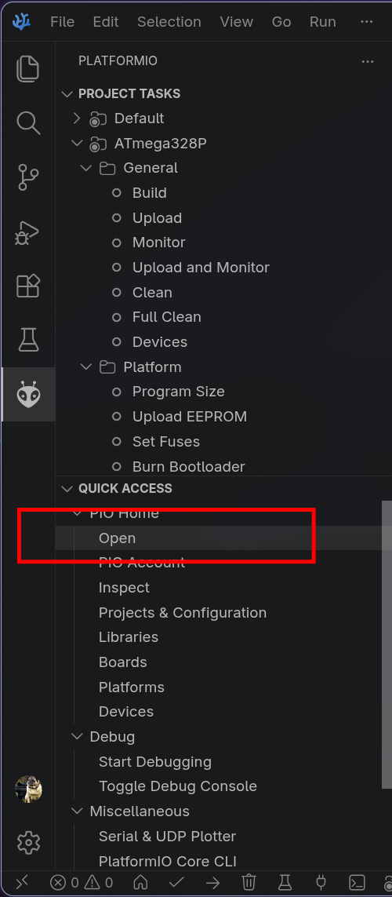
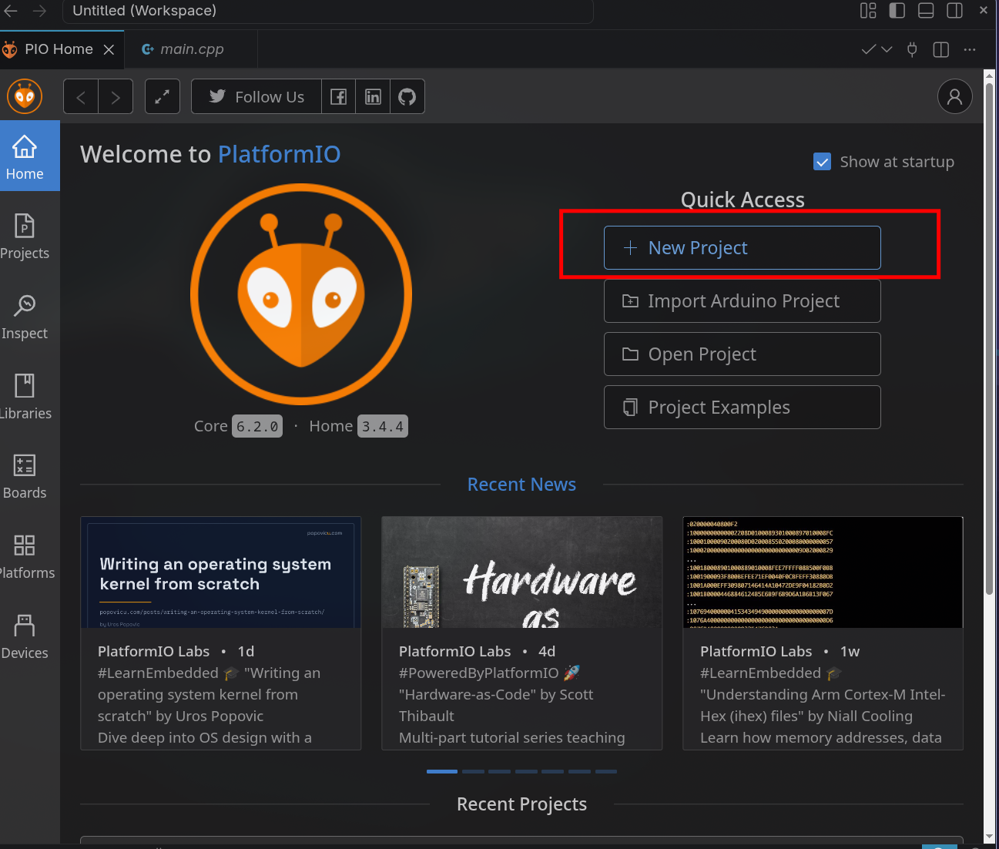
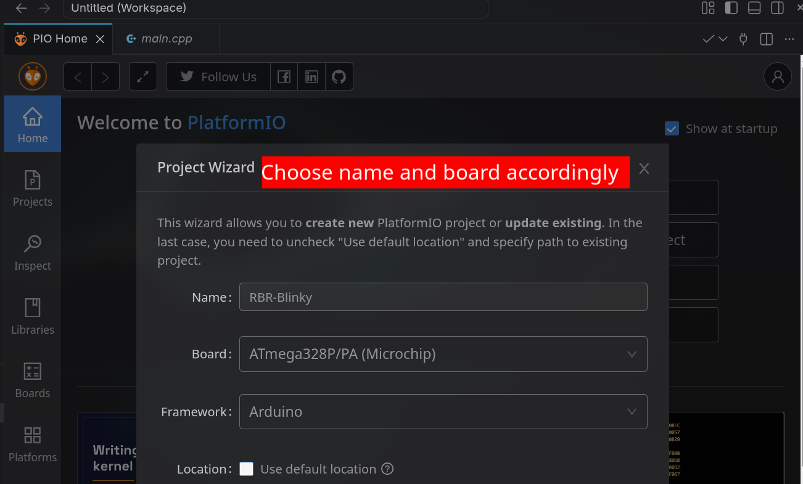
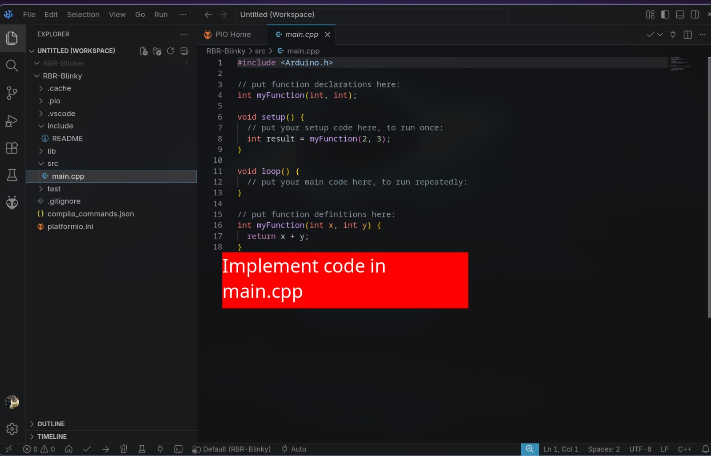
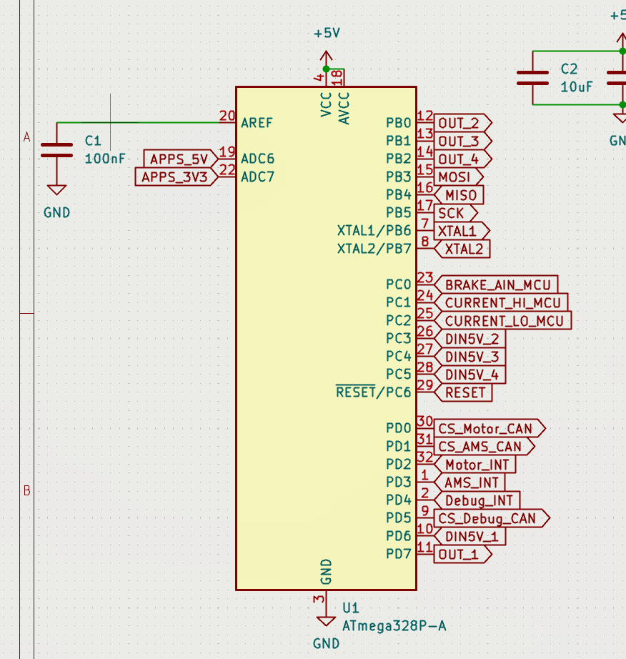

# Homework 4: Debugging and your first PlatformIO project
## Introduction
This homework has 2 parts.
- 4.1 Debugging: find the bugs in some code, and use compiler warnings to help you.
- 4.2 Blinky: make a PlatformIO project, blink an LED, then read buttons using a `board.h` pin file.

Create a repo called `rbr-sf-hw-4`, finish both parts in it, then send the link on the [training website](https://rbrevrt.hkust.edu.hk/training). Use what you learnt in [Homework 2](../Homework2/homework2.md): commit as you go, I ***WILL*** check your commit history :D.

Your repo should look like this when you are done:
```
rbr-sf-hw-4/
├── .github/workflows/
│   ├── doxygen-gh-pages.yml
│   └── pio_run.yml
├── Doxyfile
├── 4.1/
│   ├── q1.cpp
│   └── q2.cpp
└── RBR-Blinky/     <- your PlatformIO project (4.2)
    ├── platformio.ini
    ├── include/board.h
    └── src/main.cpp
```

## 4.1 Debugging
Copy [`4.1/q1.cpp`](4.1/q1.cpp) and [`4.1/q2.cpp`](4.1/q2.cpp) into your repo. Answer in the comments inside each file. Compile and run them with `g++` like in the [README](../README.md#testing-your-code). We gave you `.cpp` files because we want you to actually run the code. You are not a human compiler.

### q1.cpp
#### Part 1
For each of parts b, c and d, state the kind of error the code produces:
- Compilation error: it does not compile.
- Runtime error: it compiles, but crashes or misbehaves while running.
- Logic error: it runs, but the result is wrong.

Then explain why in no less than 10 words. Each part contains exactly one error. Part a is done for you as an example. You only need to know that `char inp[8]` holds 8 characters to see why it is an error.

#### Part 2
The code at the bottom of `q1.cpp` is meant to print `75%`. It does not.
1. Explain what the code is trying to do.
2. Find the bug making the result wrong.
3. Explain why and how it happens.
4. Fix it in the code, so it prints `75%`.

### q2.cpp
`q2.cpp` compiles, but does not do what the comment at the top says it should. Compile it with warnings on:
```
g++ -Wall -Wextra -Wshadow q2.cpp -o q2
```
You should get these 3 warnings:
```
q2.cpp:38:19: warning: suggest parentheses around assignment used as truth value [-Wparentheses]
q2.cpp:44:20: warning: statement has no effect [-Wunused-value]
q2.cpp:48:17: warning: declaration of 'delta' shadows a previous local [-Wshadow]
```
`38:19` means line 38, column 19. For each warning:
1. Explain what the warning means and how it breaks the program.
2. Fix the line.

Write your answers in the comment at the bottom of `q2.cpp`. After fixing all 3, the program should compile with no warnings, print a delta for each number you type, and exit with the right `Final Delta` when you type `-1`.

From now on, always compile with warnings on. In 4.2, PlatformIO shows them to you in the Problems tab.

## 4.2 Blinky
Blinky is the first program you write on a new board. If the LED blinks, everything from compiling to flashing works.

The board in 4.2 is imaginary: an ATmega328P with an LED on PB5 and 3 buttons on PD1 to PD3. You will not flash anything. A clean `Build` (no errors, no warnings) is what we grade.

### Task 1: Create a PlatformIO project
Install the `PlatformIO IDE` extension in VSCode if you have not. Click the PlatformIO icon (the alien) on the left bar, then `PIO Home` > `Open`.


Press `New Project`.


Fill in the information required.
- Name: `RBR-Blinky`
- Board: `ATmega328P/PA (Microchip)`
- Framework: `Arduino`
- Location: untick `Use default location`, and choose your `rbr-sf-hw-4` repo folder



Press `Finish`. The first time takes a while, since PlatformIO downloads the toolchain. When it is done, you get a project with `include/`, `src/main.cpp` and `platformio.ini`. You write your code in `src/main.cpp`.


Open `platformio.ini`. This file tells PlatformIO what board you are building for and how. Add the clock speed and warnings, so it looks like this:
```ini
[env:ATmega328P]
platform = atmelavr
board = ATmega328P
framework = arduino
board_build.f_cpu = 16000000
build_flags =
	-Wall
	-Wextra
```
Commit with the message `Create PlatformIO project`.

### Task 2: Blink the LED
An Arduino program has no `main()` you write yourself. You fill in 2 functions instead:
- `setup()` runs once at power on. Set pin modes and initial values here.
- `loop()` runs forever after `setup()`. Read inputs, process, write outputs.

You can think of it like this:
```cpp
int main() {
    setup();
    while (true) {
        loop();
    }
}
```
Replace the example in `src/main.cpp` with a program that turns the LED on for 500 ms, then off for 500 ms, forever. You need 3 functions:
- `pinMode(pin, OUTPUT);` sets a pin as an output.
- `digitalWrite(pin, HIGH);` / `digitalWrite(pin, LOW);` turns it on / off.
- `delay(ms);` waits for `ms` milliseconds.

Use `LED_BUILTIN` as the pin. Press the tick `✓` in the bottom bar (`Build`). It should end with `SUCCESS` and no warnings. On a real board, we don't use the `→` (`Upload`) button. We build, then flash the compiled `.pio/build/ATmega328P/firmware.hex` onto the chip with `progisp.exe`.

Commit with the message `Blink LED`.

### Task 3: `board.h`
Right now the LED pin is written inside `main.cpp`. In a real project, pins are used all over the code, and the electrical team moves some of them on every new board version. So we give every pin a name in one header file, and the code only uses the names. When the board changes, only that file changes. Our real boards do this, e.g. `BoardConfig.h` in the [VCU repo](https://github.com/HKUST-Red-Bird-Racing-EVRT/vehicle_control_unit).

This is part of a VCU schematic. Each MCU pin has a net label saying what it is connected to.


The pin header turns those labels into names the code can use. For example, `PD0` goes to `CS_Motor_CAN` and `PD7` goes to `OUT_1`, so the header would have:
```cpp
#define CS_CAN_MOTOR PIN_PD0
#define OUT_1 PIN_PD7
```
When you write a `board.h` for a new board, you read the schematic like this and write one `#define` per pin you use.

Copy the skeleton [`4.2/include/board.h`](4.2/include/board.h) into the `include/` folder of your project, then fill in the todos. Your `board.h` must define:

| Name | Value | Use |
|---|---|---|
| `BUTTON_1` | `PIN_PD1` | button, input |
| `BUTTON_2` | `PIN_PD2` | button, input |
| `BUTTON_3` | `PIN_PD3` | button, input |
| `BUTTON_MODE` | `INPUT_PULLUP` | pin mode for the buttons |
| `BUTTON_ACTIVE` | `LOW` | what `digitalRead()` returns when a button is pressed |

Do **not** define `LED_BUILTIN`. The board package already defines it as `PB5`, and defining it again gives you a redefinition warning. Keep using it as is.

Notes:
- A pin name is one line: `#define NAME VALUE`. Look at the VCU example above.
- `PIN_PD1` means port D, bit 1 of the chip. These names come from the board package, so you never need to look up Arduino pin numbers.
- PlatformIO adds `include/` to the include path, so `#include "board.h"` just works from `src/main.cpp`.
- The buttons connect the pin to GND when pressed, and `INPUT_PULLUP` holds the pin `HIGH` otherwise. So pressed reads `LOW`. This is why `BUTTON_ACTIVE` exists: if the next board flips the wiring, you change one line.
- An include guard stops the file from being pasted in twice if 2 files include it. Look up `#ifndef` / `#define` / `#endif`.

Add `#include "board.h"` to the top of `src/main.cpp`. Build again, it should still pass with no warnings. Commit with the message `Add board.h`.

### Task 4: Buttons
Your blink from Task 2 has a cycle time of 1000 ms (on + off) and a duty rate of 50% (on for half the cycle). Change your program so the buttons control them:
1. Press `BUTTON_1`: add 100 ms to the cycle time.
2. Press `BUTTON_2`: deduct 100 ms from the cycle time. Never go below 100 ms.
3. Press `BUTTON_3`: duty rate = (duty rate + 25%) mod 100%. It starts at 50%, so pressing it goes 50% → 75% → 0% → 25% → 50%. At 0% the LED stays off.

For example, at a cycle time of 800 ms and a duty rate of 25%, the LED is on for 200 ms, then off for 600 ms.

Each press counts once. Holding a button down must not keep changing the value. To do this, remember what the button read on the last `loop()`, and only act when it changes from not pressed to pressed.

You need 2 more functions:
- `pinMode(pin, BUTTON_MODE);` sets a button pin as an input.
- `digitalRead(pin)` returns `HIGH` or `LOW`. Compare it to `BUTTON_ACTIVE`.

With `delay()`, the board ignores the buttons while it waits, so presses get missed. Replace `delay()` with `millis()`, which returns the milliseconds since power on. Check the buttons on every `loop()`, and use `millis()` to decide whether the LED should be on or off right now.

Only use the names from `board.h`. If `PIN_P` or a pin number appears in `main.cpp`, you are doing it wrong. Build with no warnings. Commit with the message `Control blink with buttons`, then push.

### Task 5: CI/CD
Add the same workflows as [Homework 2 Task 6](../Homework2/homework2.md#task-6-cicd), so GitHub builds your code on every push and publishes the documentation.

Copy everything inside [`4.2/ci`](4.2/ci) into the **root** of your repo, not into `RBR-Blinky/`. GitHub only looks for workflows in `.github/workflows` at the root. Your repo should now have `Doxyfile` and `.github/workflows` with 2 files inside, next to `4.1/` and `RBR-Blinky/`.

The files are almost the same as Homework 2. Your PlatformIO project is in `RBR-Blinky/` this time, not the root, so the paths changed:
- `pio_run.yml` runs `pio run -d RBR-Blinky`. `-d` tells PlatformIO which folder the project is in.
- `Doxyfile` reads `INPUT = RBR-Blinky/include RBR-Blinky/src`, so the documentation is generated from your `board.h` and `main.cpp`.

Doxygen only documents files with a `@file` comment at the top. `board.h` already has one. Add one to `src/main.cpp` too, in the same style.

Commit with the message `Add CI/CD workflows`, then push. Go to the `Actions` tab and check that `PlatformIO CI` has a green tick. Set up GitHub Pages like in Homework 2, and check that your site shows `board.h` and `main.cpp`.

## Hints
- Read the instructions carefully, they are meant to help you, not distract you.
- Compile and test your code, and fix the warnings.
- Avoid using AI tools directly, since it is eliminating thinking from your working process. You can use it to help you think, but don't ask it to solve the questions for you.
- The board is imaginary, so a passing `Build` is enough. Read your code carefully, since you can't watch the LED to check it.

## Checklist
- [ ] Read the entire instructions file
- [ ] 4.1: `q1.cpp` parts b, c, d and part 2 answered, code fixed
- [ ] 4.1: `q2.cpp` 3 warnings explained, code compiles with no warnings
- [ ] 4.2: `board.h` written, project builds with no warnings
- [ ] 4.2: the 3 buttons change cycle time and duty rate, once per press
- [ ] 4.2: `main.cpp` only uses pin names from `board.h`
- [ ] 4.2: `PlatformIO CI` passes on GitHub, and the GitHub Pages site is live
- [ ] Commits for each task, pushed to GitHub
- [ ] Link to repo sent on the [training website](https://rbrevrt.hkust.edu.hk/training)
