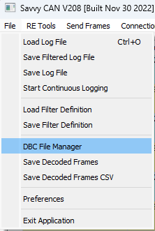
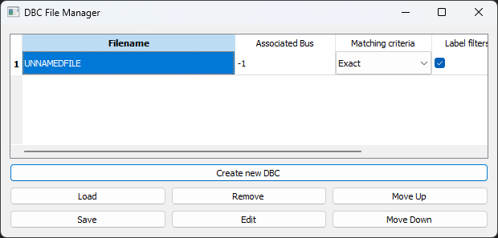
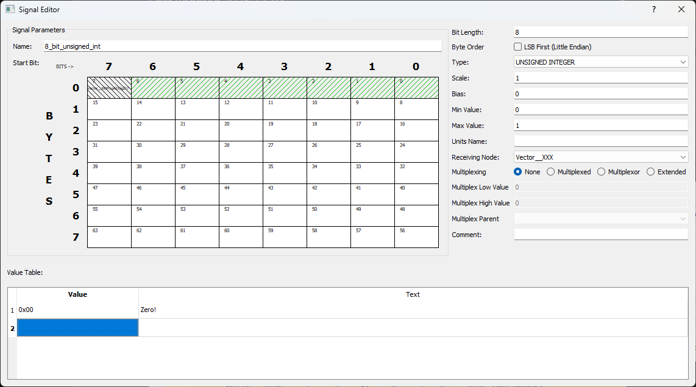
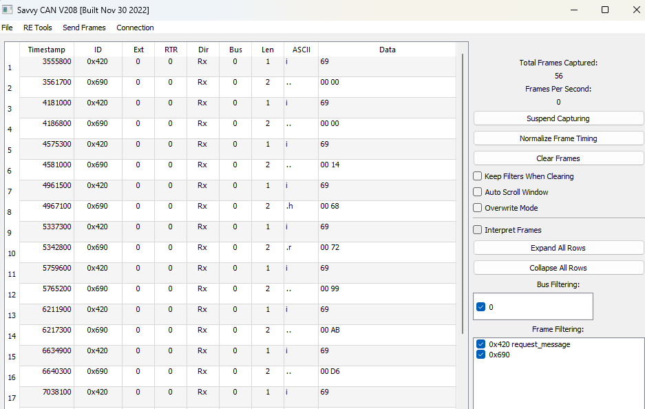
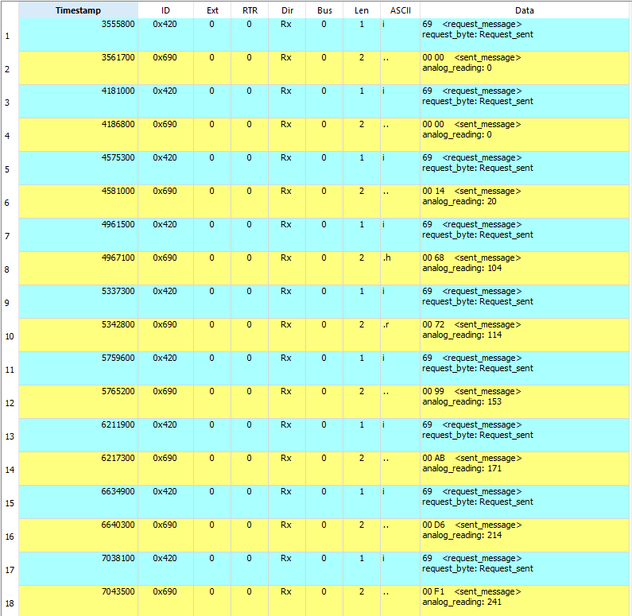

# Homework 5: CAN bus
## Introduction
This homework gives you practical experience with the CAN bus. In Q1 you write a program for an MCU that answers a request over CAN. In Q2 you take a recording of that conversation and write a `.dbc` file, so tools can decode the raw bytes into readable values.

Create a repo called `rbr-sf-hw-5`, upload your completed `q1.cpp` and `q2.dbc` to it, then send the link on the [training website](https://rbrevrt.hkust.edu.hk/training).

### Given files
- [`q1.cpp`](q1.cpp): skeleton code for Q1.
- [`hw5q2.trc`](hw5q2.trc): CAN trace file for Q2.

### Files to submit
- `q1.cpp`: completed code for Q1.
- `q2.dbc`: DBC file that decodes the given trace.

## Q1: Programming
### Introduction
Edit, then submit `q1.cpp`. The program waits for a request frame on the CAN bus, then replies with an analog reading of a dial. Complete the todos and you should arrive at a working program.

The code is for the ATmega328P on the Arduino framework, the same setup as Homework 4.2. Remember that `setup()` runs once, then `loop()` runs forever.

The board:
- MCP2515 CAN controller, connected over SPI with chip select (CS) on `PIN_PB2`. Its crystal is 20 MHz. The bus runs at 500 kbps.
- Dial (analog input) on `PIN_PC0`.
- LED (active high) on `PIN_PD2`.

`PIN_PX_Y` macros are already defined by the board package, so use them directly. Here we use the pins directly to keep the file short. On a real project they would go in `board.h`.

### Tasks
We only describe the functions to use. You figure out the parameters, and you name your own objects and variables. `canName` and `frameName` below are placeholders.

As a hint, every todo fits in a single line, except initializing the MCP2515.

#### Todo 1
Complete the setup.
- Create an MCP2515 object with CS at `PIN_PB2`.
    - `MCP2515 canName(CS_PIN);`
- Set the pin modes of the input and the LED.
    - `pinMode(PIN_NUM, INPUT);`
- Initialize the MCP2515 with the bus at 500 kbps and the crystal at 20 MHz. If you don't know which constants to use, look them up in the [library](https://github.com/autowp/arduino-mcp2515).
    - `canName.reset();`
    - `canName.setBitrate(CAN_BAUDRATE, MCP_XTAL_FREQ);`
    - `canName.setNormalMode();`

#### Todo 2
Complete the CAN receiving logic.
- Create the receiving CAN frame.
    - `struct can_frame frameName;`
- Check if a CAN frame was received.
    - `if (canName.readMessage(&frameName) == MCP2515::ERROR_OK)`
- Check the contents of the frame. Check the ID, then the payload. The payload length is in `.can_dlc`, the bytes are in the `.data` array.
    - Example: `if (frameName.can_id == 0x123 && frameName.data[0] == 0x98)`
    - For this question, check that the ID is `0x420` and the first byte is `0x69`.

#### Todo 3
Read the dial and send the reading.
- Read the analog value from `PIN_PC0`.
    - `analogRead(PIN_NUM);`
    - The reading is a 10-bit unsigned integer, so use a type that holds at least 10 bits.
- Send it with the MCP2515 object.
    - `canName.sendMessage(&frameName);`
- Keep the LED on `PIN_PD2` on while doing this.
    - `digitalWrite(PIN_NUM, HIGH);`

### Testing
Make a PlatformIO project like in Homework 4.2, put `q1.cpp` in `src/`, and add the CAN library to `platformio.ini`:
```ini
lib_deps = autowp/autowp-mcp2515@^1.3.1
```
It should build with no warnings.

## Q2: CAN `.dbc` file
### Introduction
A CAN frame is just an ID and up to 8 bytes. A `.dbc` file describes what those bytes mean: which ID is which message, and which bits form which signal. Every CAN tool can load it, so the whole team reads the bus the same way.

You will load a trace of the bus from a correctly written Q1, then write a `.dbc` that decodes it. Download [SavvyCAN](https://www.savvycan.com/) for this.

### Steps
1. Install and start SavvyCAN.
2. Load the given trace file: `File` > `Load Log File`, then choose `hw5q2.trc`.

3. Open the DBC file manager: `File` > `DBC File Manager`.
4. Press `Create new DBC`.
5. Select `UNNAMEDFILE` and press `Edit`.

6. Set the content.
    1. Press `New Message`.
    2. Double click the message, and set:
        - `Frame_ID`
        - Name (anything you like, it is an alias)
        - Text and background colour
        - Comment (optional)
    3. With the message selected, press `New Signal`.
    4. Double click the new signal, and set:
        - Name
        - Bit length
        - Byte order (`LSB First` means little endian)
        - Type
        - Which bits the signal uses, by clicking the start bit in the grid on the left
        - Value table, for values with a meaning (e.g. state names)



To view the results, close the editors and press `Save` in the DBC file manager. ***Your work is lost if you forget to save!*** Go back to the trace table, tick `Interpret Frames` on the right, then press `Expand All Rows`.


### Tasks
Make a `.dbc` file that decodes the given trace. The frames are:

| CAN ID | Data length | Data |
|---|---|---|
| `0x420` | 1 byte | `0x69`: request message. Other values: don't care. |
| `0x690` | 2 bytes | Unsigned integer, the analog reading. |

Look at how Q1 packs the reading into `data[0]` and `data[1]` before picking the byte order.

Name it `q2.dbc` and submit it.

### Sample
Your decoded trace should look like this.


## Hints
- Read the instructions carefully, they are meant to help you, not distract you.
- Avoid using AI tools directly, since it is eliminating thinking from your working process. You can use it to help you think, but don't ask it to solve the questions for you.
- Check your decoded values against the raw bytes by hand for a few rows, e.g. `00 14` should be `20`.

## Checklist
- [ ] Read the entire instructions file
- [ ] Q1: all todos done, builds with no warnings
- [ ] Q2: `q2.dbc` decodes both messages like the sample
- [ ] `q1.cpp` and `q2.dbc` pushed to GitHub
- [ ] Link to repo sent on the [training website](https://rbrevrt.hkust.edu.hk/training)
