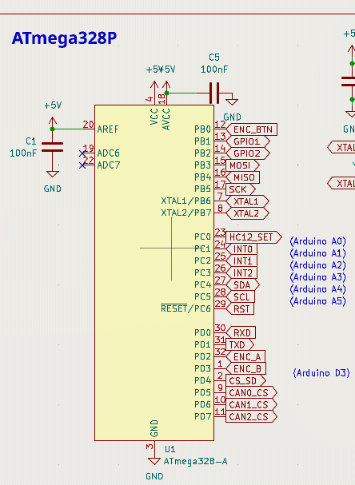

# Project: Front dash firmware
## Introduction
In this project you work on real car firmware: the front dash of the gen6 car. It's an ATmega328PA with 3 MCP2515 CAN controllers, a 20×4 LCD, an SD card logger, a rotary encoder and an HC-12 radio. (PlatformIO calls the chip `ATmega328P`. The P and PA are pin-compatible.) Parts of the firmware are cut out and marked `PROJECT TODO (Task N)`. You put them back.

This project has 5 parts.
- Part 1: Warm-up: the pin map, number formatting, a log decoder.
- Part 2: Embedded basics: timeouts, the encoder (advanced), an LCD page.
- Part 3: CAN: unpacking the VCU frames.
- Part 4: Reliability: saving the odometer, logging to the SD card (advanced).
- Part 5: Design: radio telemetry.

**Required:** Tasks 1 to 5, 7 to 10, and 12. **Advanced (optional):** Tasks 6 and 11. Some tasks use things we haven't covered in training, so they have a **Background** section that explains what you need. Every task that needs more than filling a blank has a **What to do** list. Finish the required tasks first.

***The specs in this project are not the same as the car's.*** Frame layouts, display formats, the log format and the EEPROM layout are all changed. Code copied from the race firmware does not pass the checks. Work from the comments in these files.

Create a repo called `rbr-sf-front-dash`, copy this project into it, finish the tasks, then send the link on the [training website](https://rbrevrt.hkust.edu.hk/training). Use what you learnt in Homework 2: commit as you go, I ***WILL*** check your commit history :D.

> **Note:** your git commit history may be checked. Commit after each task with the message given, so the history shows how your work progressed. One big commit at the end, or a history that doesn't match your work, will be questioned or have mark penalties. (this is also an exercise for you to get used to using git/github in general)

Your repo should look like this when you are done:
```
rbr-sf-front-dash/
├── platformio.ini
├── answers.md          <- your written answers (template given, fill it in)
├── include/            <- pinMap.h, DashState.hpp, Checks.hpp, ...
├── lib/                <- Pages/, SD_buffer/, Radio/, I2C/, Dash_I2C/
├── src/main.cpp
└── tools/              <- decode_log.py, ground_station.py, check_pinmap.py
```

### Files you edit
Only edit the files with a `PROJECT TODO` in them, plus `answers.md`. Find the TODOs with this command, or search each file with Ctrl + F:
```
grep -rn "PROJECT TODO" include lib src tools
```
Do **not** touch `lib/I2C/` and `lib/Dash_I2C/`. They are the LCD driver and they work. You only use them through `lcd.setCursorQueued()`, `lcd.printQueued()` and `lcd.writeQueued()`. IF YOU CHANGED THEM ALL YOUR ANSWERS WILL BE WRONG

Fill in the `Trainee Information` block at the top of every file you edit. `include/Checks.hpp` is the exception: you only change its `0`s to `1`s, so it needs no block.

## Checking your work
### Build
Open the project in VSCode with PlatformIO, like in Homework 4.2, and press `Build`(the tick button). The build **fails until Task 1 is done**, because the pins are missing. Until then you get errors like these, and they all mean "a pin in `pinMap.h` is still empty":
```
error: expected primary-expression before ',' token
error: no matching function for call to 'SdLogger::begin()'
```
After Task 1, keep it building with no new warnings after every task.

These warnings are already there before you change anything. Ignore them:
- `'TelemetryFramePedal::StateByteStatus::Bits::car_status' is too small to hold all values of 'enum class CarStatus'`: a GCC bug, fixed in GCC 9.3.
- `extra ';' [-Wpedantic]` from the SD library, and `ISO C++ prohibits anonymous structs [-Wpedantic]` from the SPI library: not our code.
- `unused parameter` in `Page.tpp`: part of Task 5, it goes away when you finish that task.

### Compile-time checks
`include/Checks.hpp` has tests for tasks 2, 3, 5, 6, 8, 9 and 10. When you think a task is done, change its line from `0` to `1`:
```cpp
#define CHECK_TASK_2 1
```
Then build. A wrong answer fails the build and says which case is wrong:
```
static assertion failed: Task 2: formatSignedInt2(7) should be "+07"
```
If you see `non-constant condition for static assertion` instead, the error just above it says what's wrong (often a variable without a starting value, see Task 10). Don't edit the tests to make them pass since I will run them myselves with "Hidden test cases :D". Leave every check you've passed on `1` when you submit.

### Python
Tasks 1, 4 and 12 have Python scripts. Run them with `python3 tools/check_pinmap.py`, `python3 tools/decode_log.py` and `python3 tools/ground_station.py`. On Windows, type `py` instead of `python3`.

### Hardware
You don't need a pcb to finish this project. The `(bench)` steps are optional, for when you have one on the bench.

## Before you start
Read these files in this order. Every task assumes you know them. Each has one thing to find out.
1. `src/main.cpp`: only `setup()` and `loop()`. Find out: what happens every `loop()`, and what happens every LCD tick?
2. `lib/Pages/Page.hpp`: the page interface. Find out: why `update()` must not change any variables (read the warning on it).
3. `lib/Pages/VCUPage.tpp`: a finished page. Find out: how a page moves the cursor, prints a field, and shows `N/A` when the data is old. Task 7 works the same way.
4. `include/DashState.hpp`: how the VCU packs its CAN frames. Find out: what `car.pedal.status.bits.hv_ready` is. (`status` is a union: the same byte, read either as a whole `byte` or as single named `bits`.)

## Part 1
### Task 1: Pin map
`include/pinMap.h` is the dash's `board.h`, like in Homework 4.2. Every pin is already listed as an empty `#define`. Read the schematic below: each net label (e.g. `CAN1_CS`) sits next to the ATmega328PA port pin it is wired to. Fill in the value of each `#define`. `CAN0_CS` is done for you as an example:
```cpp
#define CAN0_CS        PIN_PD5 // example follow this format of using PIN_PXY or marks would be deducted
```



The names in `pinMap.h` are close to the net labels, but not always the same: `SD_CS` is `CS_SD`, `GPIO_1` is `GPIO1`, `PIN_ENC_BTN` is `ENC_BTN`. Three names are not net labels at all. Work them out from how `main.cpp` uses them:
- `CAN_INT_BITS`: the 3 MCP2515 interrupt pins `INT0` to `INT2`, written as `{Pxn, Pxn, Pxn}`.
- `ENC_B_PINREG` and `ENC_B_BIT`: the input register of `ENC_B`'s port, and its bit inside that register.

Notes:
- Use the pin **names**: `PIN_PB3`, `PINB`, `PB3`. `#define CAN1_CS 6` gets ***no marks***, even if 6 is the right number. Nobody can check a bare number against the schematic.
- Take MOSI on the schematic as an example (it isn't in `pinMap.h`). `PIN_PB3` is the pin for `pinMode()` / `digitalWrite()`. `PINB` is port B's input register, and `PB3` is bit 3 inside it. Most lines need a `PIN_Pxn`; only the three above need the others.
- `python3 tools/check_pinmap.py` only checks that you used names. Whether the pins are right is checked when I grade.

Commit with the message `Fill in pin map`.

### Task 2: Formatting
Tasks 2, 3 and 5 are fill in the blanks. The code in `lib/Pages/Page.tpp` is written for you, with 6 blanks: one per function. Each `BLANK` is a missing value, and `BLANK_TYPE` is a missing type. The line next to each blank does the same thing, so copy its pattern. When all three tasks are done, delete the two `#define BLANK` lines at the top of the file. If you missed a blank, the build now fails and tells you where.

For this task, fill in the blanks in `hexNibble`, `formatHexByte`, `formatSignedInt2` and `formatFixedPoint2`.

#### Background
- A `char` is just a number. `'0'` is 48, `'1'` is 49, … `'9'` is 57, so `'0' + 7` is `'7'`. Letters work the same way: `'A' + 2` is `'C'`.
- One hex digit holds 4 bits (a nibble), so a byte is 2 hex digits: `0x3C` is `3` (high nibble) and `C` (low nibble).
- A C string is an array of `char` that ends with `'\0'`. The functions write into `dest`, an array the caller gives them.
- `x / 10` drops the last digit, and `x % 10` is the last digit: `25 / 10` is `2`, `25 % 10` is `5`.

We don't use `sprintf` on the dash. It costs about 1.5 KB of flash, and its output width changes with the value. On an LCD, a field that gets shorter leaves old characters behind.

The temperature clamps to ±99 because the BMS sends an `int8_t`. Without the clamp, -128 °C prints as garbage. A wrong number on a dash is worse than a pinned one.

Check: `CHECK_TASK_2`. In `answers.md`, explain why `hexNibble` uses `'A' + n - 10`. Commit with the message `Formatting helpers`.

### Task 3: Throttle
Fill in the one blank in `throttlePercent()`: the type. The sensor reads 0.5 V to 4.5 V, and the bottom and top 3 % snap to 0 / 100 so a resting foot doesn't show 1 %.

#### Background
On the AVR, `int` is only 16 bits, so it holds up to 32 767. C++ does arithmetic in `int` unless a value is bigger, so `uint16_t(818) * 100` overflows. `static_cast<T>(x)` turns `x` into type `T` *before* the multiplication, so the multiplication happens in `T`. The fixed-width types are `uint8_t` (0 to 255), `uint16_t` (0 to 65 535) and `uint32_t` (0 to about 4 billion).

Check: `CHECK_TASK_3`. In `answers.md`, explain why `uint16_t` gives a wrong answer here. Commit with the message `Throttle percentage`.

### Task 4: Log decoder
The dash logs every CAN frame to the SD card as binary records. Implement `decode()` in `tools/decode_log.py`. The steps are in the comment inside it.

#### Background
This is Python, not C++. You only need a few pieces:
- A file read in binary mode gives `bytes`: a list of numbers 0 to 255. `raw[0]` is the first byte, `len(raw)` is how many there are, and `raw[2:5]` is bytes 2, 3 and 4.
- The `struct` module turns bytes into numbers. `REC = struct.Struct("<IHB8s")` describes one record: `<` little-endian, `I` uint32 (the time), `H` uint16 (the id), `B` uint8 (the DLC), `8s` 8 raw bytes. `REC.size` is 15. `REC.unpack_from(raw, 30)` reads the record that starts at byte 30 and gives back the 4 values:
  ```python
  ms, cid, dlc, data = REC.unpack_from(raw, 30)
  ```
- `yield value` inside a function hands out one value at a time, like a `return` that keeps going. If you prefer, build a list with `.append()` and `return` it. Both pass the check.
- `raise ValueError("message")` stops with an error.

The record layout is also written at the top of `lib/SD_buffer/SD.hpp`.

Check: `python3 tools/decode_log.py` prints `self-check ok`. Commit with the message `Log decoder`.

## Part 2: Embedded basics
### Task 5: Stale data
Fill in the blank in `isStale()`. The compiler warns you which parameter is unused. The pages use it through `stale()` to show `--` when a CAN source goes quiet.

`millis()` wraps back to 0 after 49.7 days. The subtraction is still right across the wrap, but `now > last + timeout` is not. Explain why in `answers.md`. (Hint: try `last = 4 294 967 000`, `now = 100`, `timeout = 500` both ways, remembering that a `uint32_t` wraps at 4 294 967 296.)

Check: `CHECK_TASK_5`. (bench) Unplug the CAN bus: every page shows `--` / `N/A` within 0.5 s, and BMS within 2.5 s. Commit with the message `Stale data timeout`.

### Task 6: Encoder (advanced, optional)
Fill in `ENC_STEP[16]` in `src/main.cpp`. The comment above it explains the index and the direction. Draw the 4 states of the 2 pins in a circle first.

#### Background
- **Quadrature encoder.** The knob has 2 switches, A and B, a quarter step apart. Turning one way, the pins go `00 → 01 → 11 → 10 → 00` (written as BA). Turning the other way, the same states come in reverse order. One click of the knob is 4 steps (`ENC_STEPS_PER_DETENT`).
- **Interrupts.** An interrupt is a hardware event that pauses `loop()` wherever it is, runs a short function called an ISR (interrupt service routine), then carries on. ENC_A is on `INT0` and ENC_B on `INT1`. `setup()` sets both to fire on every edge (`EICRA`), and both run the same ISR (`ISR_ALIASOF`). So the ISR runs once for every change on either pin.
- **`volatile`.** `encSteps` is changed in the ISR and read in `loop()`. `volatile` tells the compiler that the variable can change at any time, so it must read it from memory every time. `loop()` also turns interrupts off (`cli()`) while it reads `encSteps`, and back on (`sei()`) after, so the ISR can't change it halfway through.
- **Lookup table.** Instead of a long chain of `if`s, the ISR builds a number from the previous state and the current state: `(previous << 2) | current`. `<< 2` moves the previous 2 bits up, and `|` puts the current 2 bits below them. For example, previous `01` and current `11` gives `0b0111`, which is 7. `ENC_STEP[7]` then says how far that move went: `+1`, `-1` or `0`. 2 bits of previous and 2 bits of current give 16 possible moves.
- **`0b0111`** is a binary literal, the same as `7`. The checks in `Checks.hpp` use them so you can read the states directly.
- **Impossible moves.** No change (e.g. `01 → 01`) is `0`. Both pins changing at once (e.g. `00 → 11`) means a step was missed, so we can't tell the direction. That is also `0`.
- **`PROGMEM`** keeps the table in flash instead of RAM, because the chip only has 2 KB of RAM. The ISR reads it with `pgm_read_byte()`. You don't need to change that part.

#### What to do
1. Write the 16 indexes `0b0000` to `0b1111` in a list. Split each into previous (top 2 bits) and current (bottom 2 bits).
2. Mark each move `+1` if it follows `00 → 01 → 11 → 10 → 00`, `-1` if it goes the reverse way, and `0` otherwise.
3. Write the 16 values into `ENC_STEP` in index order.

Check: `CHECK_TASK_6`. (bench) One click of the knob moves one page, both ways. Commit with the message `Encoder table`.

### Task 7: Status page
Finish `DefaultPage::update()` in `lib/Pages/DefaultPage.tpp`. The layout is in the comment above it, items 0 and 1 are done for you, and each of items 2, 3 and 4 has a comment saying what to print.

#### Background
- `loop()` calls `update(0)`, `update(1)` … `update(4)`, one per LCD tick. Each call redraws one field. `switch (item)` picks the field.
- Each field: move the cursor with `lcd.setCursorQueued(column, row)`, then print with `lcd.printQueued(F("text"))`. `F()` keeps the text in flash instead of RAM.
- `car.pedal.faults.bits.brake_high` is one bit of the pedal fault byte, read as a `bool`. The `bits` names are listed in `include/DashState.hpp`.
- Pad every text to its field's full width (`"OK  "`, not `"OK"`), or the end of the old, longer text stays on screen.
- `VCUPage::update()` in `lib/Pages/VCUPage.tpp` is a finished example of all this.

#### What to do
For each of items 2, 3 and 4: copy the shape of item 0. Call `setCursorQueued()` with the position in the comment, then an `if` / `else if` / `else` chain that prints one text per case, in the order the comment lists them.

There is no check for this one. Read your code against the layout carefully. (bench) With no VCU plugged in, the page shows `N/A`, and fields never flicker. Commit with the message `Status page`.

## Part 3: CAN
### Task 8: Motor frame
Finish `unpackMotor()` in `include/DashState.hpp`. `motor_rpm` is done for you as an example.

#### Background
The VCU packs each 16-bit value into 2 bytes, big-endian: the high byte first. This is the reverse of the `>> 8` and `& 0xFF` split you saw in Homework 5. To join 2 bytes back into one value, shift the high byte up 8 bits and join the low byte with `|`: `(high << 8) | low`. The byte positions are in the comment on `TelemetryFrameMotor::fromCanFrame()`, just above.

#### What to do
1. Read the comment on `TelemetryFrameMotor::fromCanFrame()` and write down which 2 bytes hold `torque_val`, `motor_warn` and `motor_error`.
2. For each one, write a line like the `motor_rpm` line, with its 2 bytes.

Check: `CHECK_TASK_8`. It packs test values with `fromCanFrame()` and checks that your function gives them back. Commit with the message `Unpack motor frame`.

### Task 9: Pedal frame
Finish `unpackPedal()` in `include/DashState.hpp`. `status`, `faults` and `brake` are done for you. It's the exact reverse of `TelemetryFramePedal::fromCanFrame()` just above it: four 10-bit fields in one 40-bit big-endian number. Here is where every bit is:
```
data[2]   data[3]   data[4]   data[5]   data[6]
BBBBBBBB  BB555555  55553333  333333HH  HHHHHHHH

B = brake, 5 = apps_5v, 3 = apps_3v3, H = hall_sensor
each from its bit 9 (left) down to its bit 0 (right)
```
So `brake` is all 8 bits of `data[2]` (its bits 9 to 2), then the top 2 bits of `data[3]` (its bits 1 and 0). The given line does exactly that: `(data[2] << 2) | (data[3] >> 6)`.

#### Background
- `&` with a mask keeps only some bits: `data[3] & 0x3F` keeps the low 6 bits (`0x3F` is `0b00111111`).
- `>> n` moves bits down by `n`, dropping the lowest `n`. `data[3] >> 6` keeps only the top 2 bits.
- `<< n` moves bits up by `n`, to make room for the bits that go below.
- `|` joins two parts that don't overlap.
- `unpackPedal()` is `constexpr`, so the compiler can run it during the build (that's how `Checks.hpp` tests it). Inside it, use only arithmetic: no `Serial`, no `millis()`.

#### What to do
For `apps_5v`, `apps_3v3` and `hall_sensor`:
1. Find its 10 bits in the diagram. They are split over 2 bytes.
2. From the first byte, keep its bits with a mask, and shift them up so they become the top part of the field.
3. From the second byte, shift its bits down to the bottom.
4. Join the two parts with `|`.

For example, `apps_5v` is the low 6 bits of `data[3]` (they become its bits 9 to 4), then the top 4 bits of `data[4]` (its bits 3 to 0).

Check: `CHECK_TASK_9`. Commit with the message `Unpack pedal frame`.

## Part 4: Reliability
### Task 10: Odometer
Implement `newestSlot()` and `saveOdometer()`, and fill in the blanks in `loadOdometer()`, all in `src/main.cpp`. `odoCrc()` is done for you. Each function has numbered steps in its comment. Saves rotate through **3** EEPROM slots.

#### Background
- **EEPROM** is 1 KB of memory inside the ATmega that keeps its data with the power off. `eeprom_read_block(destination, eeprom_address, byte_count)` copies from EEPROM into RAM. `eeprom_update_block(source, eeprom_address, byte_count)` copies from RAM into EEPROM, and only writes the bytes that changed.
- **Why 3 slots.** An EEPROM cell survives about 100 000 writes. Writing to a different slot each time spreads the wear over 3 times as many cells.
- **Slot addresses.** `ODO_EE` points to EEPROM address 0 and is used like an array of `OdoSlot`. `&ODO_EE[i]` is the address of slot `i`, and `sizeof(OdoSlot)` (6 bytes) is the size of one slot. `loadOdometer()` already reads all 3 slots at once into `s[0]` to `s[2]`.
- **CRC.** A write takes about 3.3 ms per byte, and the power can die in the middle of one, leaving a half-written slot. A CRC is a small number calculated from the data. If any byte changes, the CRC almost certainly won't match anymore. `odoCrc(slot)` calculates it from `value` and `seq`. A slot is valid when `odoCrc(slot) == slot.crc`. Blank EEPROM (all `0xFF`) is never valid.
- **Picking the newest.** Each save writes `seq + 1`. `seq` is a `uint8_t`, so it wraps from 255 to 0, and then `0` is newer than `255`. A plain `>` gets that wrong. Subtract them as `uint8_t`, then read the result as signed: `static_cast<int8_t>(a - b) > 0` means `a` is newer than `b`. For example, `0 - 255` wraps to `1`, which is positive, so `0` is newer.
- **Next slot.** The slot after `odoSlot` is `(odoSlot + 1) % ODO_SLOTS`, so it goes 0, 1, 2, 0, 1, …
- **`constexpr`.** `newestSlot()` is `constexpr`, so `Checks.hpp` can run it during the build. Give every variable a starting value where you declare it (`int8_t best = -1;`). A variable without one gives `uninitialized variable in 'constexpr' function`.

This PCB has no power-fail input wired (`PIN_POWER_FAIL` is not in `pinMap.h`), so on the car `saveOdometer()` is never called yet. You test it on the bench.

Check: `CHECK_TASK_10` tests `newestSlot()`. `loadOdometer()` and `saveOdometer()` are checked when I grade, and on the bench: add these 2 lines to `setup()`, right after `odometer_integral = loadOdometer();`, and flash once:
```cpp
odometer_integral += 15100000UL; // +1 km on the driver page
saveOdometer(odometer_integral);
```
Turn the power off and on 4 times. The odometer on the driver page shows `1.00000`, `2.00000`, `3.00000`, `4.00000` km: each boot loads the last value and saves 1 km more, and the slots wrap. Don't flash between power cycles: flashing usually erases the EEPROM too (unless the chip's EESAVE fuse is set). Remove the 2 lines when you're done. Commit with the message `Odometer in EEPROM`.

### Task 11: SD logger (advanced, optional)
Implement `SdLogger::log()` and `SdLogger::service()` in `lib/SD_buffer/SD.hpp`. `writeBuf()` and `flushAll()` are done for you. Each function has numbered steps in its comment.

#### Background
- **A class keeps state.** `SdLogger` is a class: its variables (`buf`, `count`, `active`, `pending`, `dropped`) keep their values between calls. `log()` and `service()` are functions inside the class that read and change them. Inside them, you use the variables by name, like `count[active]`.
- **Blocking.** A function blocks when it doesn't return until slow hardware is done. An SD write can block for 10 ms to 100 ms. CAN frames keep arriving, hundreds per second, and the MCP2515 only holds 2. While the CPU waits for the SD card, frames get lost. So `log()` must never write to the card. It only copies into RAM.
- **Double buffering.** There are 2 buffers, `buf[0]` and `buf[1]`. `active` says which one `log()` is filling. When it is full, `log()` marks it as waiting to be written (`pending = true`) and switches `active` to the other one. Then `service()`, called from the main loop, writes the waiting buffer to the card (`writeBuf(active ^ 1)`) while `log()` keeps filling the new one. `active ^ 1` flips 0 to 1 and 1 to 0. If both buffers are full at once, the frame is dropped and counted in `dropped`.
- **`Record &r = …`** makes `r` another name for that record in the buffer, so writing `r.ms` writes straight into the buffer.
- **`__attribute__((packed))`** tells the compiler not to add padding bytes between the fields. Each record in the file is then exactly 15 bytes, which is what your Task 4 decoder reads.

There is no check for this one. (bench) Log for 5 minutes, then decode the file with your Task 4 script. The DLCs are right, timestamps only go up, and there are no big gaps. Commit with the message `SD double buffer`.

## Part 5: Design
### Task 12: Radio
The dash sends telemetry to the pit over an HC-12 radio. `lib/Radio/` already builds the frames and sends them. You decide what goes in them, fill them in, send them at a fixed rate, and write the ground station program that reads them. This has no single right answer, so bring your design to me ***before*** you write the code.

#### Background
- **UART.** A UART sends bytes one bit at a time over a wire, at a fixed speed called the baud rate. At 115200 baud, one byte (8 bits plus a start and a stop bit) takes about 87 µs.
- **The HC-12** is on the chip's hardware UART: `RXD` / `TXD` on the schematic, which is `Serial` in the code. `main.cpp` already creates `Radio radio(Serial);` and calls `radio.begin()`. The HC-12 is in transparent mode: whatever bytes go into the one on the car come out of the one at the ground station. It doesn't know where a frame starts or ends, and bytes can get corrupted on the way.
- **`Serial.write()` doesn't wait** for the bytes to go out. It puts them in a 32-byte buffer, and the hardware sends them in the background. A frame is 31 bytes, so it fits. Send too often and the buffer fills up, and then `write()` waits, which slows down CAN reading. Once every 100 ms (`RADIO_PERIOD_MS`) is plenty.
- **Framing.** `Radio::send()` already sends each frame as `[0x7E][time 4][type 1][data 24][checksum 1]`, 31 bytes. `0x7E` marks the start, so the receiver can find it. `time` is `millis()`, little-endian. The checksum is the time, type and data bytes added up, cut to 8 bits (the start byte is not included). The receiver adds them up itself and throws the frame away if the sum doesn't match.
- **Payload.** You choose what goes into the 24 `data` bytes and how. The comment in `Radio::updateVcu()` lists every value you can use.

#### What to do
1. **Design.** In `answers.md`, fill in the table: for each of the 24 bytes, which value it holds, its type and its byte order. Say why the pit crew needs each value. Commit with the message `Radio design`, then show me before going on.
2. **Firmware.** In `lib/Radio/Radio.cpp`, fill in `updateVcu()` to write `frame.data` exactly as in your table.
3. **Timing.** In `loop()` in `src/main.cpp`, call `radio.updateVcu()` every `RADIO_PERIOD_MS`. Use `millis()` and `lastRadioMs`, like the button timing in Homework 4.2 Task 4. No `delay()`.
4. **Ground station.** In `tools/ground_station.py`, implement `find_frames()` (steps in its comment), then `decode_vcu()` to match your table. `python3 tools/ground_station.py` tests `find_frames()`. To decode real data, save the ground HC-12's bytes to a file with a serial terminal, then run `python3 tools/ground_station.py capture.bin`.

Check: `python3 tools/ground_station.py` prints `self-check ok`, and the project builds. Commit with the message `Radio telemetry`, then push.

## Questions
Answer these in `answers.md`, in no less than 2 sentences each.
1. `Page::update()` must not change any state. Why? Hint: find `beginDryRun` in `main.cpp`.
2. What does the watchdog (`wdt_enable`) protect against? What happens if a page's `update()` takes 1.2 s?
3. The LCD driver is reset if its queue is stuck for 500 ms. What real fault does that handle?
4. Why are the custom characters and strings stored with `PROGMEM` / `F()`?
5. Find one place where the code trusts CAN data it shouldn't. What is the worst outcome?

## Hints
- Commit after every task. Your commit history may be checked.
- Read the instructions carefully, they are meant to help you, not distract you.
- Do the required tasks in order. Later ones use the earlier ones. Start the advanced tasks only when the required ones are done.
- Read the code around your task before writing anything. The **What to do** steps and the comments in the code tell you what to write.
- Compile and test your code, and fix the warnings.
- Avoid using AI tools directly, since it is eliminating thinking from your working process. You can use it to help you think, but don't ask it to solve the questions for you.

## Checklist
- [ ] Read the entire instructions file
- [ ] Task 1: `pinMap.h` uses pin names only, `check_pinmap.py` passes, project builds
- [ ] Tasks 2, 3, 5: every blank filled, `#define BLANK` lines deleted
- [ ] Tasks 2, 3, 5, 8, 9, 10: check set to `1`, builds
- [ ] Task 4: `decode_log.py` self-check passes
- [ ] Task 7: done, read against the layout
- [ ] Task 10: `loadOdometer()` and `saveOdometer()` done
- [ ] Task 12: design committed and shown to me before the code, `ground_station.py` self-check passes
- [ ] `answers.md`: Tasks 2, 3, 5 explanations, Task 12 table, Questions 1 to 5
- [ ] (advanced) Task 6: check set to `1`, builds
- [ ] (advanced) Task 11: done, read against the steps
- [ ] `Trainee Information` filled in every file you edited
- [ ] Commits for each task, pushed to GitHub
- [ ] Link to repo sent on the [training website](https://rbrevrt.hkust.edu.hk/training)
